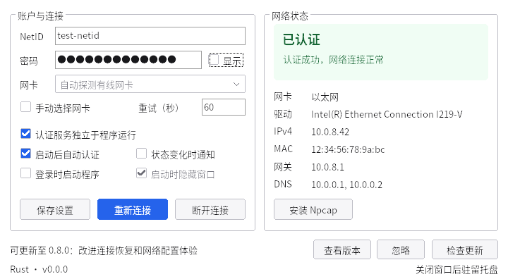
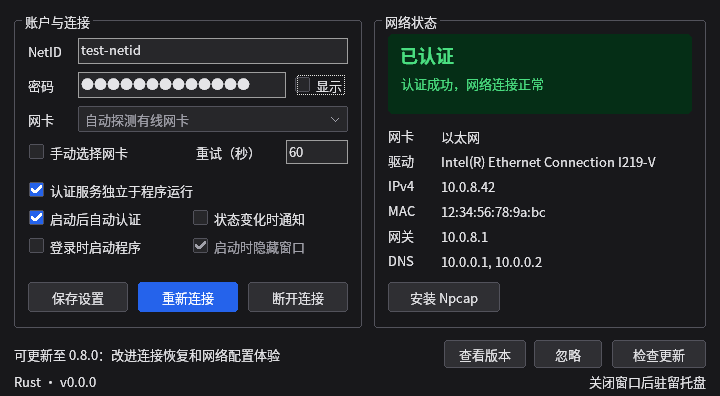

# SYSU NetAuth

中山大学有线校园网 802.1X / EAP-MD5 自动认证客户端，使用 Rust 实现。Windows 提供原生图形界面、命令行和后台服务；Linux 与 macOS 提供命令行和系统服务。

当前版本为 **v0.7.0-beta.2**。程序内只检查正式版更新，测试版请从[发布页](https://github.com/LoveElysia1314/sysu-netauth/releases/tag/v0.7.0-beta.2)下载。

## 下载与安装

| 平台 | 下载文件标识 | 使用方式 |
| --- | --- | --- |
| Windows 10/11 x64 | `Rust_msvc_x64` | 原生界面、命令行、后台服务 |
| Windows 10/11 ARM64 | `Rust_msvc_arm64` | 原生界面、命令行、后台服务 |
| Linux x64 | `Rust_linux_x64` | 命令行、systemd 服务 |
| macOS 11+ Apple Silicon / Intel | `Rust_macos_arm64` / `Rust_macos_x64` | 实验性命令行、launchd 服务；尚无图形界面 |

Windows 用户下载 `Setup` 安装包，按提示安装 [Npcap](https://npcap.com/#download)。安装后填写 NetID 和密码，点击“重新连接”。启用“启动后自动认证”和“认证服务独立于程序运行”后，可退出窗口，由后台服务继续认证和续期。

一般选择 Windows MSVC 安装包。发布页也提供 x64 GNU 构建、Windows 便携包和各平台的 SHA-256 校验文件。

- [Windows 安装与排障](docs/WINDOWS.md)
- [Linux 安装与服务管理](docs/LINUX.md)
- [macOS 安装与服务管理](docs/MACOS.md)

macOS 原生 GUI 已提供[源码开发预览](macos/README.md)，包含菜单栏、登录启动、状态通知和授权 helper；尚未纳入正式发行包，校园网认证仍需实机验证。

## 功能

- 自动选择有线网卡，支持按设备固定选择和失败后切换候选网卡。
- 持续响应交换机的重新认证请求，自动处理断线和 Windows 睡眠、休眠恢复。
- 网卡插拔时更新选择列表，保留尚未保存的选择。
- Windows 界面跟随系统浅色或深色主题，提供托盘状态、登录启动和通知选项。
- 后台检查正式版更新，支持手动检查、查看发布说明和忽略指定版本。

程序负责有线认证，IP 地址和 DHCP 由系统网络管理器处理。使用前请退出其他 802.1X 客户端。

## 界面

以下为使用示例数据的界面截图。





## 文档与开发

[命令行与配置](docs/CLI.md) · [源码构建](docs/BUILDING.md) · [架构](docs/ARCHITECTURE.md) · [测试](docs/VALIDATION.md) · [性能测量](docs/PERFORMANCE.md) · [发行维护](docs/RELEASING.md)

从仓库根目录构建：

```sh
cargo build --locked --release
```

Windows 构建需要 Visual Studio C++ 工具和 Windows SDK；制作安装包还需要 Inno Setup 6。各平台的依赖、输出目录和交叉编译方法见[构建文档](docs/BUILDING.md)。

版本说明见 [GitHub Releases](https://github.com/LoveElysia1314/sysu-netauth/releases)。
